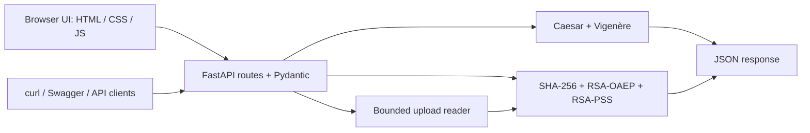

# Architecture and design decisions

## Component flow

CryptoGraph is a single Python service serving static web assets and stateless cryptographic API requests. **There is no database, user account system, key vault or message history.**

## Responsibilities

| Component | Location | Responsibility |
| --- | --- | --- |
| Entry point | `main.py` | Creates app and serves the static frontend |
| App factory | `app/api/main.py` | Router registration, API metadata, health check |
| HTTP layer | `app/api/routes_*.py` | HTTP validation/errors and contract mapping |
| Schemas | `app/api/schemas.py` | Pydantic request/response validation; RSA bounds |
| Historical algorithms | `app/classical/` | Caesar/Vigenère with testable Python functions |
| Cryptography primitives | `app/modern/` | SHA-256 and RSA via standard libraries |
| Facade | `app/services/crypto_service.py` | Optional reusable service API; HTTP routes currently call algorithm modules directly |
| Files | `app/utils/file_io.py` | Application-level 10 MiB upload limit |
| Frontend | `static/` | Vanilla JS state, API calls and UI |
| Verification | `tests/` | Unit tests and FastAPI TestClient tests |

## Design choices

**FastAPI and Pydantic** give automatic, inspectable OpenAPI documentation, typed request bodies and standard HTTP validation errors.

**Vanilla JS** deliberately keeps the front end framework-free so reviewers can see request construction, DOM rendering and error handling directly.

**Standard crypto packages** are used for RSA-OAEP and RSA-PSS. Implementing RSA padding manually would be unsafe and unnecessary. Caesar and Vigenère are written directly only because they are teaching examples.

**Stateless operation** means no application persistence is required for a demo, but also no authentication or durable key lifecycle exists.

## RSA signing data flow

1. A user generates a **disposable test key pair**; the API returns public and private PEM text.
2. The user selects the RSA sign operation and enters sample data.
3. Browser JS sends the message and private PEM to `POST /api/modern/rsa/sign`.
4. FastAPI validates JSON, the RSA-PSS implementation signs the bytes, and the API returns a Base64 signature.
5. Verification uses the public PEM, input text and signature.

**Trust boundary:** This is **not** client-side encryption. Private PEM data is available to the server during generation, decryption and signing. Never upload real private keys.

## Resource limits and known gaps

- RSA key generation is restricted to 2048–4096 bits; excessive key-size requests fail validation.
- File endpoints read at most 10 MiB plus one sentinel byte, returning HTTP 413 on oversized files.
- Other routes lack global body-size limits and there are no quotas or authentication.
- RSA routes offload work to a dedicated two-thread executor. A cancelled request holds its slot until the worker finishes.
- No database, rate limiter, structured production telemetry or recovery programme.
- Dependencies specify minimum versions, not a fixed lockfile.
- Docker and Render configuration exist but live hosting is not guaranteed.

## Suggested review path

`main.py` → `app/api/main.py` → `app/api/routes_modern.py` → `app/modern/rsa_crypto.py` → `app/modern/signatures.py` → `tests/test_api.py`.

See [API reference](API.md), [reviewer guide](REVIEWER_GUIDE.md), and [security notes](../SECURITY.md).
